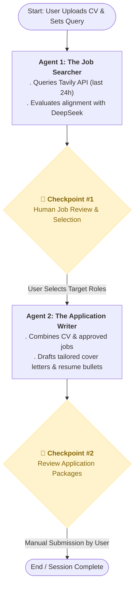

# 🤖 Autonomous Multi-Agent Job Search & Application Assistant

An intelligent, stateful multi-agent system built with **Python**, **LangGraph**, 
**DeepSeek** and **Tavily**. 

This application automates the tedious parts of the job search lifecycle:

- Scraping fresh remote roles
- Evaluating resume alignment
- Drafting tailored cover letters
- Optimizing resume bullet points

while keeping you firmly in control via **Human-in-the-Loop (HITL)** checkpoints.

---

## 🏗️ Architectural Overview & Multi-Agent Flow



---

## 🛠️ Tech Stack & Engineering Highlights

* **Orchestration Framework:** **LangGraph** (manages state persistence, 
state graphs and native execution interrupts).
* **LLM Layer:** **DeepSeek** (`deepseek-chat` via LangChain `ChatOpenAI` client) 
utilizing raw JSON extraction and prompt engineering for robust structured outputs.
* **Search Engine:** **Tavily API** configured with advanced search depth, time 
constraints (`time_range="day"`) and domain filtering (`include_domains`) targeting 
top Applicant Tracking Systems (Greenhouse, Lever, Ashby, LinkedIn).
* **State Persistence:** **LangGraph SqliteSaver** checkpointing, allowing workflows 
to survive server restarts and browser refreshes across multi-threaded sessions.
* **User Interface:** **Streamlit** reactive web application providing clean review 
panels and checkboxes.

---

## 📁 Project Structure

```text
job-agent-system/
├── agent.py              # LangGraph workflow, state schema, and Agent 1 & 2 logic
├── app.py                # Streamlit web UI and HITL checkpoint control loops
├── utils.py              # PDF resume parser and DeepSeek LLM client initialization
├── requirements.txt      # Project Python dependencies
├── .env                  # API keys (git-ignored)
└── job_sessions.sqlite   # Local persistent state checkpointer (git-ignored)
```

## 🚀 Getting Started

### 1. Clone the Repository & Setup Virtual Environment

```bash
git clone [https://github.com/your-username/job-agent-system.git](https://github.com/your-username/job-agent-system.git)
cd job-agent-system

python3 -m venv venv
source venv/bin/activate  # On Windows use: venv\Scripts\activate
```

### 2. Install Dependencies

```bash
pip install -r requirements.txt
```

### 3. Configure Environment Variables

Create a `.env` file in the root directory and add your API credentials:

```text
DEEPSEEK_API_KEY=your_deepseek_api_key_here
TAVILY_API_KEY=your_tavily_api_key_here
```

### 4. Run the Streamlit Application

```bash
streamlit run app.py
```

Open your browser to the local URL provided by Streamlit (usually http://localhost:8501), upload your PDF resume and launch your automated job search!

## 💡 Key Software Engineering Takeaways

+ **Separation of Concerns:** Pure business logic and graph workflows (`agent.py`) are strictly decoupled from I/O utilities (`utils.py`) and presentation layers (`app.py`).
+ **Resilient LLM Parsing:** Manual JSON extraction and Pydantic validation bypass strict schema limitations on OpenAI-compatible endpoints, ensuring zero runtime crashes from malformed model responses.
+ **State Management:** Leveraging graph checkpointers allows stateful pause-and-resume workflows without losing operational context.

---

## 🤝🏽 Let's Connect!

| Platform | Link |
| :--- | :--- |
| **Technical Blog** | [https://grace-sampao.github.io/](https://grace-sampao.github.io/) |
| **LinkedIn** | [Grace Sampao](https://www.linkedin.com/in/grace-sampao) |
| **X** | [@grace-sampao](https://x.com/grace_sampao) |
| **Email** | sampaograce@gmail.com |
